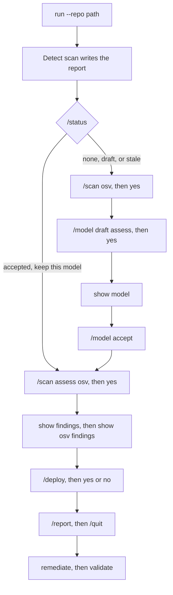

# Silent Blue


Silent Blue is a defensive security harness. It inventories a repository, looks for missing or weak security controls, ranks those gaps, and writes one report a person can review.

The default detect profile is deterministic: scope, detectors, deduplication, ranking, and report rendering make no model calls and leave source unchanged. The assess profile adds a bounded review through the provider named in `.env`. After a report exists, `deploy` reviews the edge, `remediate` writes a case file per confirmed source gap, and `validate` records a verdict from a read-only review.

Run a review from the command line, or from the session prompt with `run`. The prompt is also what an agent drives: a slash command or a sentence that maps to one command, one repository at a time. Drafting and accepting a threat model happens in the prompt. A later command-line scan uses that acceptance. The full order is in [How to run](#how-to-run). When a line is unexpected, use the [troubleshooting guide](docs/troubleshooting.md).

Run every command from this directory. `python -m silentblue` is the command to use. A scan you are not authorized to run should not be started.

## Requirements

- Python 3.11 or newer


## Run a detect scan

From this directory, on Windows:

```powershell
python -m pip install -e ".[dev]"
python -m silentblue setup
python -m silentblue estimate --repo examples/sample
python -m silentblue scan --repo examples/sample
```

On macOS the same commands run in Terminal:

```bash
python -m pip install -e ".[dev]"
python -m silentblue setup
python -m silentblue estimate --repo examples/sample
python -m silentblue scan --repo examples/sample
```

`setup` checks Python, config, the state directory, the OSV URL, and whether a CA bundle can be loaded. It makes no model call and does not call OSV. A ready detect setup prints `env file: absent`, `config: ok (detect)`, `state: ok`, `model_calls: 0`, `assess key: absent`, `Provider:`, `Model:`, `Endpoint:`, `ca bundle: ok`, and `osv url:` with the endpoint. It also prints `This check does not call the model.` `ca bundle: missing` is followed by the reason and the `.env` setting that fixes it. The next lines are the estimate and scan commands for `examples/sample`.

`estimate` prints the file count and `model_calls: 0`. `scan` writes the report and leaves `examples/sample/app.py` unchanged. The sample query is built by concatenation, so the report contains one `sql-unparameterized` finding. Open:

```text
examples/sample/security-scan/findings.json
```

The same run also writes Markdown, SARIF, HTML, and PDF next to `findings.json`. Markdown labels each finding with `Severity:`, `File:`, `Line:`, and separate `CVSS score:`, `CVSS version:`, and `CVSS vector:` lines, then `Description:`, `Evidence:`, and `Remediation:`. HTML uses those same labels. PDF is that Markdown as text and loads nothing. `--format json,md` writes only those two. Add `yaml` to the list when you want `<repo>_<timestamp>_report.yaml`, the same record as `findings.json`. The default list is `json,md,sarif,html,pdf`. A `run_manifest_*.json` file is written in the current directory.

`estimate` prints `estimated_cost_usd` before any model call. A detect estimate is `0.0000`. An assess estimate is a list-price allowance from the dated table in the package, bounded by the call and excerpt caps. The scan prints `actual_cost_usd` from the token counts the provider returns. When those counts are missing, the actual cost is `unknown`. Set both `SILENTBLUE_PRICE_INPUT_PER_MILLION` and `SILENTBLUE_PRICE_OUTPUT_PER_MILLION` to price a model that is not in the table.

To scan a repository you maintain, replace `examples/sample` with that path. The path must be a real directory.

## Session

This is the session half of [How to run](#how-to-run). A new repository and a repository that already has `security-scan` start with the same command. The opening scan tells you which branch to follow. Assessment, deploy, remediate, and validate are part of this workflow. Open a new `run --repo` for each repository in a set.

Prepare once from this directory, using the install and `setup` commands in [Run a detect scan](#run-a-detect-scan). Set the API key in [Use a model](#use-a-model) before the assessment. Detect, `/model draft`, `/model assume`, and `/model accept` make no model call and do not need the key.

Open the prompt. Replace the path with a real directory you maintain.

```powershell
python -m silentblue run --repo C:\path\to\repo
```

The session runs a detect scan first. Stage lines look like `d0  completed`. An assess stage also prints `d4  running` while it waits. The scan replaces `<repo>/security-scan/findings.json` and writes Markdown, SARIF, HTML, and PDF beside it. Source stays unchanged. The prompt is `silentblue>` on the same line as your typing. On a terminal, the prompt, labels, stage ids, finding numbers, and slash commands use one blue. The rest stays the terminal default. Set `NO_COLOR` to turn the blue off.

A question such as `what model am I using?` names the provider, model, endpoint, and price. It does not call the model. `why is the CA bundle missing?` is answered from the Python running the session. The same cases are written out in the [troubleshooting guide](docs/troubleshooting.md). The answer names that Python, the certificate-store result, and what still runs while the bundle is missing. A sentence maps to the same tools as the slash commands. `show findings`, `scan osv`, and `accept the threat model` are enough, and a small typo such as `shwo findngs` still maps. When two tools are about equally close, the session prints `ask` and runs neither. `/status` prints a `next` line chosen from the threat-model state. The harness owns that step. The model does not.

`/model accept` and `/model assume` still run as soon as you type the slash form. The sentence forms ask `yes` or `no` first. Scans, deploy, and `/model draft assess` already ask. The next line has to be exactly `yes` or `no`. Text in a source file, a lockfile, an advisory, or the model's own reply is not that answer.

A sentence that asks to change the mission, drop or hide a finding, mark a false positive, or scan a different repository is refused. The reply is `refuse  mission` and no tool runs. When a sentence matches no tool, and `SILENTBLUE_API_KEY` is set, one short model call may map it. That call sees the sentence and a session card: repository name, threat-model state, advisory state, and the finding count. It does not see source, lockfiles, or finding text. The model may name one existing command. A gated command still waits for your `yes`.

`/cost` prints the cost since this session started. It splits that total across scan, assess, threat-model, and NLP calls, then lists each model with its call count, input tokens, output tokens, thinking tokens, and USD. A scan with no model call stays at zero. Thinking tokens are shown on their own and are not added on top of the output price. A scan from before this session is not included.

Type `/status` and follow the row for the `threat model` line. The comprehensive steps are the same for a new repository and for an existing draft or stale model. An accepted model can keep its current draft and skip ahead.


| `/status`  | What the opening scan did                                                 | Comprehensive steps                                          |
| ---------- | ------------------------------------------------------------------------- | ------------------------------------------------------------ |
| `none`     | Severity order. No threat-model file yet.                                 | [New repository](#new-repository)                            |
| `draft`    | Severity order. A draft is in the repository and has not been accepted.   | [New repository](#new-repository). This replaces the draft. |
| `accepted` | Cited files first, with a threat-model line on each gap.                  | [Existing repository](#existing-repository)                  |
| `stale`    | Severity order. The draft changed, or a cited file is no longer in scope. | [New repository](#new-repository). This replaces the draft. |





### New repository

`/status` prints `threat model  none` and a `next` line. The opening scan is a detect report and `advisories` is `off`. Set the API key before step 3. These steps write one report that holds the detector gaps, the assess review, and the OSV rows, ordered by a threat model that cites those rows.

1. Type `/status`.
2. Type `/scan osv`. The session prints the OSV URL, the package count, and the CA bundle result, then asks `Continue? yes/no`. `CA bundle: missing` is followed by what to set in `.env`. Type `yes`. Type `no` to leave the detect report unchanged.
3. Type `/model draft assess`. The session prints `estimated_cost_usd` and asks `Continue? yes/no`. Type `yes`. This spends one model call. It writes `security-scan/threat-model.json` and `threat-model.html` from the current findings, including the advisory rows, and adds the assumptions from that call. The copy in the repository stays a draft.
4. Type `show model`. `/model` is the same command. Type `/model assume <text>` when you want another assumption. That changes the draft hash.
5. Type `/model accept`. The hash is stored under the state directory, outside the repository. Findings stay open. An assess scan uses the model only after this step.
6. Type `/scan assess osv`. The session prints the cost estimate and the OSV preview, then asks `Continue? yes/no` once. Type `yes`. This spends the assess budget and queries OSV again, so the advisory rows stay in the report. The review reads files named by the accepted model first, then files that already have a gap.
7. Type `show findings` for the full report. Type `show osv findings` for the advisory rows. `/findings osv` is the same command. The number on an OSV row is its number in the full report, so `/finding 12` opens that gap.
8. Continue at [Leave and follow up](#leave-and-follow-up). Run [Deploy](#deploy) before you quit when this repository holds the edge.

`/model draft` writes the same finding draft and makes no model call. Use it when you want to skip the assumption call in step 3. Accept it, then continue at step 6. `show findings` lists every gap. `/finding 1` opens one gap. A case id also works.


### Existing repository

**Accepted, and this model should stay.** `/status` prints `threat model: accepted`. The opening scan already used it.

1. Type `show findings`.
2. Type `/scan assess osv`, read the estimate and the OSV preview, then type `yes`.
3. Type `show findings`, then `show osv findings`.

The accepted draft does not gain the advisory assets from this scan. Follow [New repository](#new-repository) from step 2 when those rows should be cited. `/model draft assess` replaces the draft, and the old acceptance no longer matches until you accept again.

**Draft or stale.** Follow [New repository](#new-repository) from step 2. `/scan osv` loads the advisory rows, and `/model draft assess` replaces the draft from that report. A stale model is the old acceptance. Accepting it again keeps that draft and leaves the new advisory rows uncited.


### Advisories

Pin, install-verification, and CA-bundle checks run on every detect scan, including the scan that opens the session. They read the tree and send nothing.

OSV is off until you name it. Type `/scan osv`. The session prints the OSV URL, where that URL came from, the resolved package count, and the CA bundle result, then waits for `yes` or `no`. `CA bundle: missing` is followed by the reason. A missing system store names the Python that cannot see certificates. On a Mac, run `Install Certificates.command` for that same Python, quit the session, and start it again. If `certifi` is installed for that Python and its file sits outside the repository, Silent Blue uses that file. On Windows, install Python from python.org and install the Windows root certificate updates. Leave `SILENTBLUE_CA_BUNDLE` unset after that. `no` leaves the last report as it was. `/scan assess osv` prints the cost estimate and that same preview, then waits once. `/scan assess` without `osv` stays offline.

`/scan` and the scan that `run` starts stay offline. The scan that opens `run` keeps the OSV rows when the resolved packages match the last query, and the scan message says they were kept. That scan does not send a new query. When the packages changed, or the last query did not record the package set, the rows stay out and the message tells you to type `/scan osv`. A later `/scan` or `/scan assess` replaces `findings.json` and drops advisory rows unless that command also says `osv`. `/scan resume` finishes assess units already started. It does not send another query and it does not keep advisory rows. Run `/scan osv` again after it when you want them.

`/finding 1` prints the same labels as the Markdown finding, including the CVSS score, version, and vector. A package advisory also prints the component, package URL, and fixed version. `/status` adds `advisories: off`, `advisories: queried`, or `advisories: degraded`. `show osv findings` lists only the `dependency-vulnerable` rows. `/findings osv` is the same command. The number on each row is its number in the full report, so `/finding 12` still opens that gap.

The order that cites those rows in the threat model is [New repository](#new-repository): `/scan osv`, then `/model draft assess`, then `/model accept`, then `/scan assess osv`.

### Assessment

Run this after `/model accept`, so the review reads named files first and then files that already have a gap. The comprehensive command is `/scan assess osv`.

1. Type `/scan assess osv`. The session prints `estimated_cost_usd` and the OSV preview, then asks `Continue? yes/no` once.
2. Type `yes` to run the assess profile and query OSV. Type `no` to keep the current report. `no` makes no model call and sends no query.
3. After `yes`, type `show findings`, then `show osv findings`.

`/scan assess` without `osv` runs the same review and drops the advisory rows. Use it when this report should stay offline.

A large tree stays one scan and one `findings.json`. The estimate also prints `workers`, `estimated_units`, `source_files`, and `files_in_budget`. After `yes`, the prompt returns and the review runs in the background. Type `/status` for the stage, units finished, and model calls. Type `/findings` for the last finished report. Type `/quit` to stop after the units already started, then `/scan resume` later to continue. Resume finishes units already started. It does not send another OSV query, and the report it writes has no advisory rows. Run `/scan osv` again after it when you want them. The default budget is 20 units and 40 calls. For a larger tree set `SILENTBLUE_MAX_UNITS`, `SILENTBLUE_MAX_CALLS`, and optionally `SILENTBLUE_MAX_COST_USD` and `SILENTBLUE_WORKERS` before you start. The finished report repeats how many source files the model read.

### Leave and follow up

1. Type `/report` for `findings.json` and the latest Markdown, HTML, PDF, and SARIF files. A YAML report is listed when the scan wrote one. Type `/help` any time for the command list.
2. Type `/quit`.
3. From this directory, with the same repository path:

```powershell
python -m silentblue remediate --repo C:\path\to\repo
python -m silentblue validate --repo C:\path\to\repo
```

`remediate` writes `<repo>/security-remediation/<case_id>.json` for each gap whose verdict is `detector` or `confirmed`. Source stays unchanged. Add `--fix` only when you want an accepted patch applied. `validate` records a verdict from a read-only review and leaves source unchanged. Both need the API key.

Accept the threat model from the prompt. A later one-shot `scan` or `scan --profile assess` uses that acceptance and does not ask again. One-shot commands do not open the prompt.

## How to run

Every path below starts in this directory. Replace the sample paths with directories you maintain. The command line runs one command and exits. The session stays open at `silentblue>` until `/quit`. An agent uses that same prompt, with a slash command or a sentence, or the Python calls in [From code](#from-code).

Detect and assess send no traffic unless the scan is run with `--osv` or `/scan osv`. That query is one batch request to `SILENTBLUE_OSV_URL`, and in the session it waits until you confirm. A pinned set larger than 1000 packages is split into further requests to the same host. `deploy` sends one GET to the URL you name, and only after you confirm.

### One repository

Command line. The threat model is accepted in the session first when you want named files read before the rest.

```powershell
python -m silentblue estimate --repo C:\path\to\repo
python -m silentblue scan --repo C:\path\to\repo
python -m silentblue scan --repo C:\path\to\repo --osv
python -m silentblue scan --repo C:\path\to\repo --profile assess
python -m silentblue deploy --repo C:\path\to\repo --url https://app.example
python -m silentblue remediate --repo C:\path\to\repo
python -m silentblue validate --repo C:\path\to\repo
```

`estimate` and the detect `scan` make no model call. `--osv` sends one batch request to `SILENTBLUE_OSV_URL` and makes no model call. `--profile assess` prints nothing and spends the model budget immediately, so run `estimate --profile assess` first when you want the cost before that scan. After the threat model is accepted in a session, the comprehensive one-shot is `scan --repo C:\path\to\repo --profile assess --osv`. `scan --profile assess` without `--osv` replaces the report and drops advisory rows. `remediate` and `validate` need the API key. `deploy` does not.

Session. This is the diagram above.

```powershell
python -m silentblue run --repo C:\path\to\repo
```

1. Type `/status`.
2. For a new repository, a draft, or a stale model, follow [New repository](#new-repository). For an accepted model you want to keep, follow [Existing repository](#existing-repository).
3. Follow [Deploy](#deploy) when this repository holds the edge.
4. Type `/report`, then `/quit`.
5. Run `remediate` and `validate` from the command line for confirmed source gaps.


### Several repositories

A frontend, a backend, and a component library are three reviews. Each keeps its own `security-scan/findings.json` and its own threat model. Finish them in that order. Run deploy once, on the repository that holds the edge (proxy, load balancer, ingress, or Terraform), after the other reports exist.

Command line. Run the comprehensive scan for each path after that path's threat model is accepted. The list below is the order, not one shell loop.

```powershell
python -m silentblue scan --repo C:\src\web --profile assess --osv
python -m silentblue scan --repo C:\src\api --profile assess --osv
python -m silentblue scan --repo C:\src\ui --profile assess --osv
python -m silentblue deploy --repo C:\src\web --url https://app.example --deploy-dir C:\src\infra
```

Accept each threat model in a session before the assess scan that should use it. `--profile assess --osv` is the comprehensive one-shot for that path. A later `scan` without `--osv` replaces the report and drops the advisory rows. `batch` stays a detect-only list. It does not assess, query OSV, draft a model, or deploy.

```powershell
python -m silentblue batch --list examples/repos.txt
```

`examples/repos.txt` is one path per line. Blank lines and lines that start with `#` are skipped.

Session. Open one prompt per repository. `/quit` before the next path.

```powershell
python -m silentblue run --repo C:\src\web
```

In that prompt, complete the one-repository session steps through assessment, then `/quit`. Do the same for `C:\src\api`, then `C:\src\ui`.

Deploy is a separate prompt on the repository that holds the edge. In this example the frontend repo is that repository, and the Terraform lives beside it, so the live request is set before the prompt and the extra directory is passed on the command line:

```powershell
$env:SILENTBLUE_DEPLOY_URL = "https://app.example"
python -m silentblue run --repo C:\src\web
```

Type `/deploy`, then `yes`. The session reads files inside `C:\src\web`. When the edge files are only in `C:\src\infra`, run this from the command line instead of a fourth prompt:

```powershell
python -m silentblue deploy --repo C:\src\web --url https://app.example --deploy-dir C:\src\infra
```

The edge threat model is the frontend model. It should name the public listener, the origin, and the data store. After `/deploy`, type `/model draft` if those deployment gaps should become assets, then `/model accept` and `/scan`.

On macOS the same commands run in Terminal. Set the URL with `export SILENTBLUE_DEPLOY_URL=https://app.example` before `run`.

A later prompt could read a workspace file kept outside those trees. This version does not read that file. The roles are the order you already run by hand:

```json
{
  "name": "product",
  "repos": [
    {"role": "frontend", "path": "C:/src/web"},
    {"role": "backend", "path": "C:/src/api"},
    {"role": "components", "path": "C:/src/ui"}
  ]
}
```


### Deploy

Run this after a source report exists for that repository. `findings.json` has to be there. Deploy appends rows to that report. Verdict `declared` comes from the files. Verdict `observed` comes from the one request, or from the account snapshot. `remediate` does not turn these rows into patches. A second deploy replaces the previous deployment rows and leaves the source rows in place.

The files it reads are Terraform (`.tf`), compose files, `nginx.conf`, and YAML under a directory named `deploy`, `infra`, `k8s`, `kubernetes`, `helm`, `nginx`, `proxy`, or `gateway`. `--deploy-dir` adds one more real directory, inside or outside the repository. Links that leave that directory are not opened.

Command line:

```powershell
python -m silentblue deploy --repo C:\path\to\repo --url https://app.example --snapshot C:\secrets\account.json --deploy-dir C:\src\infra
```

Leave off `--url` when you only want the file review. Leave off `--snapshot` when you have no account file. Leave off `--deploy-dir` when the edge files are already in the repository.

Session. The prompt has no flags. Put the URL and the snapshot in the environment before `run`, then:

```text
/deploy
```

The prompt prints three lines and waits:

```text
deployment files  4
url  https://app.example
account  C:\secrets\account.json
Continue? yes/no
```

`yes` runs the review. `no` leaves the report unchanged. `url  not set` means no request is made. `account  not observed` means the snapshot was not set. An external `--deploy-dir` is command-line only. The session reviews the repository you opened.

The account file is JSON, outside the repository:

```json
{
  "listeners": [{"port": 443, "protocol": "https"}],
  "rules": [{"port": 22, "cidr": "0.0.0.0/0"}],
  "waf_attached": false,
  "public_origin": false
}
```

`SILENTBLUE_DEPLOY_URL` and `SILENTBLUE_DEPLOY_SNAPSHOT` are the environment names. A flag on the command line wins over the environment. The URL is `http` or `https`, with a host and no password in it. Certificate checks stay on. One GET is sent. A redirect to another host is written down and not followed. The snapshot is refused when it sits inside the repository you are reviewing.

Declared gaps are an origin with no proxy or load balancer, a public listener left on clear text, a public listener with no WAF attached, an admin or data port open to the whole internet, and a proxy that copies a client-supplied forwarded header. Observed gaps are the same facts taken from the snapshot, plus the certificate name and expiry, a missing HTTPS redirect, and cookie flags on `Set-Cookie`. A WAF that is attached is a control present. It is not evidence the WAF stops an attack.

After deploy, type `/model draft` when the edge should join the threat model, then `/model accept` and `/scan`.

### From code

`silentblue.sdk` is the same order for a caller. Threat-model draft and accept stay in the session.

```python
from silentblue.sdk import deploy, scan

scan(r"C:\src\web")
scan(r"C:\src\web", osv=True)
scan(r"C:\src\web", profile="assess")
scan(r"C:\src\api", profile="assess")
scan(r"C:\src\ui", profile="assess")
deploy(
    r"C:\src\web",
    url="https://app.example",
    snapshot=r"C:\secrets\account.json",
    deploy_dir=r"C:\src\infra",
)
```

`scan` uses detect until `profile="assess"`. `osv=True` queries OSV for that call. `deploy` makes no model call.

## Use a model

Detect, ingest, batch, and deploy do not need a key. Assess, remediate, and validate do. Deploy's one request uses the URL you pass, not the model key.

```powershell
Copy-Item .env.example .env
```

Edit `.env` in this directory and set `SILENTBLUE_API_KEY` to a key for the provider you want. `SILENTBLUE_PROVIDER` is `openai`, `anthropic`, `grok`, or `gemini`. `gpt`, `claude`, `xai`, and `google` are aliases. Leave `SILENTBLUE_BASE_URL` and `SILENTBLUE_MODEL` commented to use that provider's default endpoint and model. The defaults are listed in `.env.example`.

Run `python -m silentblue setup` again. It should print `env file:` with the path of your `.env`, and `assess key: present`. It still does not print the key and does not call the provider.

The prompt order for a new or existing repository, including assessment and deploy, is in [How to run](#how-to-run). The same review as one shot:

```powershell
python -m silentblue scan --repo examples/sample --profile assess
python -m silentblue deploy --repo examples/sample --url https://app.example
python -m silentblue remediate --repo examples/sample
python -m silentblue validate --repo examples/sample
```

`remediate` writes `examples/sample/security-remediation/<case_id>.json` and does not change source. Add `--fix` only when you want an accepted patch applied. Without a key, these three commands exit 2 and write no report.

Put the env file at `~/.silentblue/.env` instead when you scan this Silent Blue checkout. A `.env` inside the repository being scanned is ignored.

## More commands

```powershell
python -m silentblue doctor
python -m silentblue batch --list examples/repos.txt
python -m silentblue ingest --repo examples/sample --sarif examples/sample/security-scan/<timestamp>_report.sarif
python -m silentblue gc
```

`doctor` repeats the setup checks, including the model route, and makes no network call. The [troubleshooting guide](docs/troubleshooting.md) starts from that output. `batch` runs a detect scan for each path in the list. Blank lines and lines that start with `#` are skipped. `ingest` reads a SARIF 2.1.0 file. Use the `*_report.sarif` file from the scan you just ran. `gc` prunes old checkpoints and leaves reports on disk.

Artifacts land in `<repo>/security-scan/`:

- `findings.json` — typed report, replaced on the next scan. This is the file an agent should read
- `<repo>_<timestamp>_report.md` — the same findings as labeled text. Each gap starts at `## Finding <number>:`
- `<repo>_<timestamp>_report.html` — the same labels in one self-contained file
- `<repo>_<timestamp>_report.pdf` — the Markdown text
- `<repo>_<timestamp>_report.sarif` — SARIF 2.1.0 for code-scanning tools
- `<repo>_<timestamp>_report.yaml` — the same fields as `findings.json`. Written only when `--format` includes `yaml`

A run manifest is written to the working directory, or to `--manifest-dir`. Checkpoints live under the state directory (`SILENTBLUE_STATE_DIR`, or `~/.silentblue/state`), which must sit outside the repository.

## Pipeline


| Stage            | What it does                                                          | Model call           |
| ---------------- | --------------------------------------------------------------------- | -------------------- |
| D0 Scope         | Walks the repository and drops anything that resolves outside it      | No                   |
| D1 Context       | Records languages, manifests, and control-related paths               | No                   |
| D2 Control model | Names the controls to review. Skipped by detect                       | Assess only          |
| D3 Units         | Builds file sets from named controls, then walks the remaining source | No                   |
| D4 Assessment    | Reads each unit against its playbooks                                 | Assess only          |
| D5 Bind          | Checks cited lines, exact pins, install verification, and CA bundle paths. OSV runs after this stage only when the scan asks for it | No                   |
| D6 Review        | Confirms, rejects, or marks each model gap inconclusive               | Assess only          |
| D7 Dedup         | Collapses nearby hits of the same rule                                | No                   |
| D8 Prioritize    | Orders gaps and mints `sb1_` case ids                                 | No                   |
| D9 Report        | Writes JSON, Markdown, SARIF, HTML, and PDF from one object. YAML when `--format` includes it | No                   |
| D10 Remediate    | Writes one case file per confirmed gap. Report-only unless `--fix`    | One call per gap     |
| D11 Validate     | Three reviewers read a temporary copy. The host records the verdict   | Three calls per case |
| deploy           | Reads the edge files and one named URL. Appends candidate gaps        | No                   |


`--stop-after` accepts `d0` through `d9`. Analysis stops at that stage. A successful scan still writes the report, so `--stop-after d0` produces an empty finding list and the scope metrics. On the detect profile, D2, D3, D4, and D6 are skipped. D10, D11, and `deploy` are separate commands. `scan` leaves source unchanged.

An assess run still reads source when the model names no controls. The report is hollow only when no source unit was built and the detectors also reported nothing. That empty result is untrusted. A model reply that is not valid JSON is dropped after one retry, and the scan is marked degraded.

## Commands


| Command     | Purpose                                                                         |
| ----------- | ------------------------------------------------------------------------------- |
| `setup`     | Confirm Python, config, and the state directory                                 |
| `doctor`    | Same checks, with no network calls. Reports whether a CA bundle loads           |
| `estimate`  | Count in-scope files and bytes                                                  |
| `run`       | Open the session prompt after a detect scan. Sentences map to the slash commands. `/cost` totals this session. The step order is in How to run |
| `scan`      | Run the detect pipeline. `--profile assess` adds the model review. `--osv` queries OSV |
| `deploy`    | Review edge files and one named URL. Appends gaps to the current report         |
| `remediate` | Write case files under `security-remediation`. `--fix` applies accepted patches |
| `validate`  | Record a host verdict on each case. Source stays unchanged                      |
| `ingest`    | Import SARIF 2.1.0 results into the report                                      |
| `batch`     | Detect-scan every repository in a list                                          |
| `gc`        | Prune old checkpoints. Reports already written are left in place                |


## Exit codes


| Code | Meaning                                                                 |
| ---- | ----------------------------------------------------------------------- |
| 0    | The scan finished and wrote a report                                    |
| 1    | The run failed, an assess stage was degraded, or an OSV query did not complete |
| 2    | The config, scope, path, or a missing assess credential refused the run |


An empty scope exits 2 and writes no report. A symlinked `security-scan` directory exits 2 and is not followed. The meaning of each failure line is in the [troubleshooting guide](docs/troubleshooting.md).

## Configuration

The detect profile ships with the package. `--config` must point at a file outside the repository. A `config.local.yaml` beside that file overrides it and must also live outside the repository. A `config.yaml` discovered inside the repository is ignored.

`advisories: osv` in that config turns on the OSV query for a one-shot `scan`. The session stays offline until `/scan osv` or `/scan assess osv`. `SILENTBLUE_OSV_URL` in `.env` is the HTTPS endpoint that query POSTs to. When it is unset, the query uses `https://api.osv.dev/v1/querybatch`. `SILENTBLUE_CA_BUNDLE` names a CA file outside the repository being scanned. When it is unset, the query uses the system bundle. `setup` prints `ca bundle: missing` and the fix when that bundle cannot be loaded.

Scope defaults skip VCS metadata, virtual environments, `node_modules`, build outputs, and files larger than 512 KiB. Directory links, including Windows junctions, are never followed. File links are inventoried only when `scope.follow_symlinks` is true and the target stays inside the repository. The default is false.

## Findings

Each finding names a control family, a rule, a file and line, a case id, and a remediation note. Case ids look like `sb1_` plus 32 hexadecimal characters. They join `findings.json`, the Markdown report, the SARIF `partialFingerprints["sbFindingId/v1"]` field, and `security-remediation/<case_id>.json`. `findings.json` is schema `1.1`. Every finding has a report `number`, a CVSS v3.1 score, and a CVSS vector. A source finding's vector is the one named for its rule, in the same band as its severity. An OSV finding keeps the score and vector from the advisory, plus `advisory_id` and the package `component`. A source finding's component is the file. Severity remains the Silent Blue rank used to order the report.

In Markdown, HTML, PDF, and `/finding`, the number is the heading `Finding <number>: <title>`. The facts are `Label:` lines. `File:` and `Line:` are separate. `CVSS score:`, `CVSS version:`, and `CVSS vector:` are three lines. `Description:`, `Evidence:`, and `Remediation:` follow. `Playbook:` is printed only when a playbook is set. A package advisory adds `Component:`, `Package URL:`, and `Fixed:` when a fixed version is known. A source finding does not repeat the file on a component line. The YAML file uses the `findings.json` field names rather than these labels.

Findings are candidates. The deterministic pass covers Python, JavaScript, TypeScript, Ruby, C, C++, Rust, Go, Java, PHP, C#, and shell. The checks look for secrets and default passwords, SQL and document-query construction, directory filters, shell execution, dynamic code execution, templates compiled from strings, headers and markup taken from request data, outbound URLs, file paths, and redirect targets taken from the request, unsafe object decoders, weak password hashes and token generators, unauthenticated ciphers, JWT verification turned off, cookie flags turned off, CSRF checks turned off, request bodies copied into models, request limits turned off, debug flags, host and browser controls turned off, logging turned off, dependencies that are not an exact pin, cleartext dependencies, installs that turn verification off, a relative CA bundle that is not in the repository, downloads piped into a shell, and wide workflow permissions. Tokens in web storage, credentials in logs, certificate checks, and open cross-origin settings remain in the same pass. PyPI and npm declarations are the pin check. A lockfile in the same directory (`package-lock.json`, `poetry.lock`, or `Pipfile.lock`) that names the package suppresses the pin finding.

The assess pass uses those families. In an excerpt it can also record a login or upload handler with no limiter in the shown lines, an object id with no owner comparison, and a password login with no expiry and no second factor in the shown lines. A clean report means these checks did not record a gap. Detect and assess do not prove a deployed limit or review process evidence. They send no traffic unless the scan is run with `--osv` or `/scan osv`, which reads resolved lockfile versions, or an exact manifest pin when that directory has no lockfile, and records one `dependency-vulnerable` finding per advisory. A lockfile hit records whether the package is direct or transitive. The lockfiles are `package-lock.json`, `npm-shrinkwrap.json`, `yarn.lock`, `pnpm-lock.yaml`, `poetry.lock`, `Pipfile.lock`, `uv.lock`, `go.mod`, `Cargo.lock`, `Gemfile.lock`, `composer.lock`, `gradle.lockfile`, `packages.lock.json`, and `conan.lock`. `pom.xml` contributes an explicit version only when the directory has no Gradle lockfile. A range with no lockfile is not sent. Deploy sends one request to the URL you name and records deployment gaps as candidates.

Logs and report text pass through redaction for secret-shaped values. File paths are kept so a reviewer can open the line.

## Develop

```bash
python -m pip install -e ".[dev]"
python -m pytest
```

Python callers use `silentblue.sdk`:

```python
from silentblue.sdk import deploy, scan
```

`scan` uses the detect profile unless `profile="assess"` is set. Pass `osv=True` to query OSV. `deploy` makes no model call. The call order for one repository and for several is in [From code](#from-code). The CI workflow in `.github/workflows/silentblue.yml` runs the test suite and a detect scan. That scan does not pass `--osv`.

See [docs/architecture.md](docs/architecture.md) for the stage contracts and the safety boundaries.